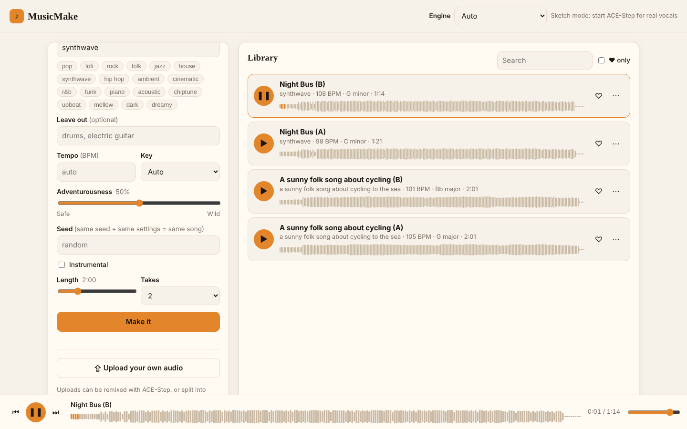
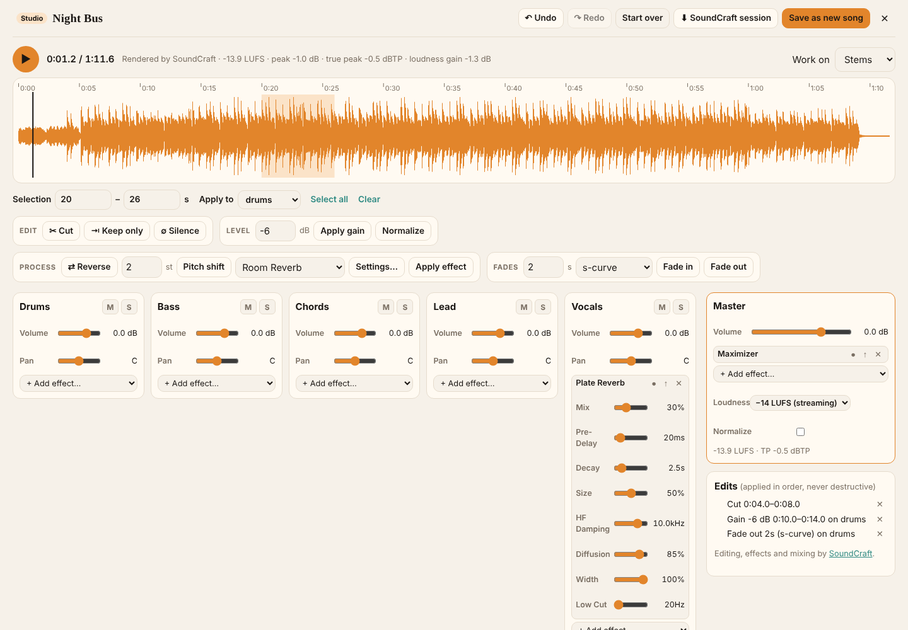

# MusicMake

A private music maker that runs on your own computer. Describe a song or write lyrics, then
play, keep, extend, remix, split into stems and download the takes it makes.



- **Works without a GPU.** The built-in *Sketch* engine arranges and synthesises whole songs
  (drums, bass, chords, lead and a sung "la-la" vocal of your lyrics) on the CPU in a few seconds.
- **Realistic songs with a GPU.** Connect [ACE-Step 1.5](https://github.com/ace-step/ACE-Step-1.5)
  (MIT, under 4 GB VRAM) for full production with real-sounding vocals.
- **Stems.** Sketch songs come with stems; other songs are split with
  [Demucs](https://github.com/facebookresearch/demucs).
- **Studio, powered by [SoundCraft](https://github.com/storytold/soundcraft).** Cut, trim, silence,
  region gain, fades, reverse, pitch shift and offline effects on a waveform you can select on.
  A mixer with volume, pan, mute, solo and 24 built-in plugins per track (EQ, compressor, gate,
  de-esser, reverbs, delay, chorus, saturator…), a master chain with a loudness target, and
  LUFS/true-peak metering. Everything is non-destructive and undoable. Save the result as a new
  song, or download a `.scraft` session for the full SoundCraft app.
- **Lyric helper.** Claude writes structured lyrics when an Anthropic key is set; offline, you get a
  template to fill in.
- **Private.** It listens on 127.0.0.1 only, and your songs stay in a folder on your disk.

## Run it

**On a laptop with a GPU, in VS Code:** follow [docs/laptop-setup.md](docs/laptop-setup.md). One
setup script installs everything, and the VS Code task **Start everything** runs it. To check what's
ready at any time, run `python -m musicmake doctor`.

By hand:

```sh
pip install -r requirements.txt
python -m musicmake            # then open http://127.0.0.1:8765
```

Options: `--data <folder>` (where songs go, default `./data`), `--port`, and
`--engine auto|sketch|acestep`. MP3 export and uploads need `ffmpeg` on your PATH.

### Real vocals with ACE-Step 1.5 (optional, GPU)

```sh
git clone https://github.com/ace-step/ACE-Step-1.5 && cd ACE-Step-1.5
uv sync && uv run acestep-api          # serves http://127.0.0.1:8001
```

Leave the engine on **Auto** and MusicMake uses ACE-Step whenever that server is up. Use
`ACESTEP_URL` and `ACESTEP_API_KEY` if you run it elsewhere or with a key.

### Stems for any song (optional)

```sh
pip install demucs
```

### Studio editing with SoundCraft (optional)

```sh
cargo install --git https://github.com/storytold/soundcraft soundcraft-cli   # Rust 1.90+
```

Or set `SOUNDCRAFT_CLI` to the path of a `soundcraft-cli` you already have. Then open any song's
**⋯ → Edit in Studio**.



### Lyric helper with Claude (optional)

```sh
pip install anthropic
export ANTHROPIC_API_KEY=...           # or sign in with `ant auth login`
```

It uses `claude-opus-5-5` at low effort, with Anthropic's server-side refusal fallback turned on.
Set `MUSICMAKE_LYRICS_MODEL` to use a different model.

## Tests

```sh
pip install pytest
python -m pytest
```

The Studio end-to-end tests run only when `soundcraft-cli` is installed.

## How this project was planned

[PLAN.md](PLAN.md) is the plan: a clean-room study of suno.com's public pages using
[Craft Anything](https://github.com/storytold/craft-anything#under-the-hood), then an original design.

- [docs/suno-analysis.md](docs/suno-analysis.md): what was learnt, and how.
- [docs/musicmake-spec.md](docs/musicmake-spec.md): the product spec and engine mapping.
- [research/](research): the Craft Anything project (evidence, findings, open questions) and its report.

MusicMake is for personal use. Songs made with ACE-Step fall under ACE-Step's own licence and
responsible-use notes. Don't put other people's copyrighted lyrics or recordings into it unless
you have the rights to them.
